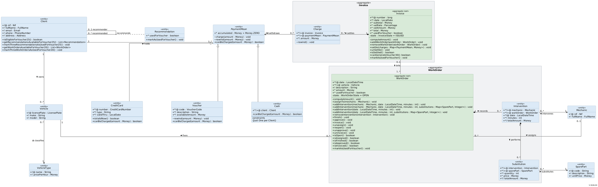

# CWS (Car Workshop System) - Sistema de Gestión de Taller Mecánico

## Tabla de Contenidos
1. [Descripción General](#descripción-general)
2. [Modelo del Dominio](#modelo-del-dominio)
3. [Conceptos Fundamentales](#conceptos-fundamentales)
4. [Arquitectura del Proyecto](#arquitectura-del-proyecto)
5. [Patrones de Diseño](#patrones-de-diseño)
6. [Patrón: Table Data Gateway (TDG) Puro](#patrón-table-data-gateway-tdg-puro)
7. [Explicación: Por qué PaymentMean está en Persistence pero no en Service](#explicación-por-qué-paymentmean-está-en-persistence-pero-no-en-service)
8. [Guía de Implementación de una Nueva Entidad](#guía-de-implementación-de-una-nueva-entidad)

---

## Descripción General

**CWS** es un sistema de gestión para talleres mecánicos que gestiona:
- **Clientes**: registro y CRUD de clientes
- **Órdenes de Trabajo**: trabajo realizado en vehículos
- **Facturas**: facturación de servicios
- **Bonos/Vouchers**: programa de bonificación automática por órdenes de trabajo

Este proyecto implementa **generación automática de bonos**: cuando un cliente acumula **3 órdenes de trabajo completadas**, el sistema automáticamente genera un cupón (bono) que puede usar como medio de pago.

### Requisitos del Proyecto
Solo se implementan dos casos de prueba:
- **Test 1**: Generación de bonos por 3 órdenes de trabajo + Gestión CRUD de clientes
- **Test Clients**: Gestión CRUD de clientes solamente

---

## Modelo del Dominio



### Entidades Principales

**1. Cliente (Client)**
- Identificado por NIF (número de identificación fiscal)
- Propiedades: nombre, teléfono, email, dirección
- Relación: 1 cliente → N órdenes de trabajo, N bonos

**2. Orden de Trabajo (WorkOrder)**
- Identificada por código único
- Propiedades: descripción, fecha, estado (OPEN/FINISHED), vehículo, cliente
- Relación: 1 cliente → N órdenes de trabajo
- Estado: OPEN (abierta) → FINISHED (terminada)

**3. Bono/Voucher**
- Identificado por código único
- Propiedades: fecha de creación, descripción, estado (AVAILABLE/EXPIRED/REDEEMED)
- Relación: pertenece a 1 cliente
- Se genera automáticamente tras 3 órdenes terminadas

**4. Medio de Pago (PaymentMean)**
- Pago en efectivo (CASH) o bono (VOUCHER)
- Registra pagos realizados contra facturas

**5. Factura (Invoice)**
- Documento de facturación
- Relación: factura → N medios de pago
- El cliente paga mediante efectivo o bonos

### Relaciones Clave

- **Cliente** → Posee N **Órdenes de Trabajo** y N **Bonos**
- **Orden de Trabajo** → Generada por 1 **Cliente**, completada = contribuye a bono
- **Bono** → Pertenece a 1 **Cliente**, se crea cuando acumula 3 órdenes
- **Factura** → Se paga mediante N **Medios de Pago** (CASH o VOUCHER)

---

## Conceptos Fundamentales

### ¿Qué es un DTO (Data Transfer Object)?

Un **DTO** es un objeto que **transporta datos** entre capas del proyecto. Es como un "mensajero" que lleva información de un lado a otro.

**Analogía del mundo real:**
- Tienes una **base de datos** (almacén) con la información original
- Un **DTO** es como una **fotocopia** de esa información
- La UI no accede directamente al almacén, recibe la fotocopia (DTO)

**¿Por qué?** Porque protege la base de datos de cambios accidentales desde la UI.

**Ejemplo en el proyecto:**
```java
// En la capa Service, definimos DTOs como clases internas:
public interface ClientCrudService {
    class ClientDto {
        public String nif;
        public String name;
        public String phone;
        // ... más propiedades
    }
}
```

### ¿Qué es un Assembler?

Un **Assembler** es una clase que **convierte datos de una forma a otra**. Es como un "traductor" entre diferentes formatos de información.

**Analogía:**
- Tienes un objeto de base de datos (Record)
- Necesitas convertirlo a DTO para la UI
- El Assembler hace esa conversión

**Ejemplo:**
```java
// Convertir de Record (BD) a DTO (UI)
ClientDto dto = new ClientDto();
dto.nif = record.getNif();
dto.name = record.getName();
return dto;
```

### ¿Qué es un Gateway?

Un **Gateway** es una clase que **comunica con la base de datos**. Es como un "puente" entre el código Java y las tablas SQL.

**Analogía:**
- Tú eres un cliente que quiere información
- El Gateway es como el gerente de una oficina
- Tú le pides información y él va a la base de datos a buscarla

**¿Por qué existe?** Porque aisla toda la lógica SQL en un solo sitio, facilitando cambios futuros.

**Ejemplo:**
```java
public interface ClientGateway {
    ClientRecord findByNif(String nif);
    void add(ClientRecord record);
    void update(ClientRecord record);
}
```

### ¿Qué es un Command (Patrón Command)?

Un **Command** es una clase que **empaqueta una acción completa** con validación y ejecución. Es como una "orden" que se puede ejecutar posteriormente.

**Analogía:**
- Un mesero en un restaurante toma tu pedido
- Lo escribe en un papel (Command)
- La cocina ejecuta ese pedido después

**¿Por qué?** Porque separamos **qué hacer** de **cómo hacerlo**, facilitando pruebas y transacciones.

**Ejemplo:**
```java
public class AddClient implements Command<ClientDto> {
    private String nif, name, phone;
    
    public ClientDto execute() {
        // Validar datos
        // Crear cliente en base de datos
        // Retornar DTO
    }
}
```

### ¿Qué es un Service?

Un **Service** es una clase que **orquesta operaciones de negocio**. Es como un "coordinador" que decide qué hacer.

**Analogía:**
- Un proyecto de construcción necesita un coordinador
- El coordinador pide presupuestos, contrata obreros, supervisa trabajo
- El Service es ese coordinador, pero para lógica de negocio

**¿Por qué?** Porque centraliza la lógica de negocio (validaciones, reglas) en un lugar.

**Ejemplo:**
```java
public class ClientCrudServiceImpl implements ClientCrudService {
    public ClientDto add(ClientDto dto) {
        var command = new AddClient(dto);
        return commandExecutor.execute(command);
    }
}
```

### ¿Qué es la Inyección de Dependencias?

**Inyección de Dependencias** = pasar objetos que necesitas como **parámetros** en lugar de crearlos internamente.

**Analogía:**
- En lugar de que un empleado compre sus propias herramientas
- La empresa le proporciona las herramientas (inyección)

**En nuestro proyecto:** Usamos un **Service Locator** (patrón alternativo):
```java
// En lugar de inyectar en constructor:
ClientGateway gateway = Factories.getInstance().getServiceFactory()
    .getClientGateway();
```

---

## Arquitectura del Proyecto

El proyecto sigue una arquitectura de **capas** (layered architecture):

```
┌─────────────────────────────────────────┐
│ CAPA UI (Interfaz de Usuario)           │ ← Menús, entrada del usuario
├─────────────────────────────────────────┤
│ ↑↓ DTOs (Data Transfer Objects)         │ ← Frontera de datos
├─────────────────────────────────────────┤
│ CAPA SERVICE (Lógica de Negocio)        │ ← Servicios, Commands, validaciones
├─────────────────────────────────────────┤
│ ↑↓ Records (Objetos de Persistencia)    │ ← Frontera de datos
├─────────────────────────────────────────┤
│ CAPA PERSISTENCE (Acceso a Datos)       │ ← Gateways, JDBC, SQL
├─────────────────────────────────────────┤
│ BASE DE DATOS                           │ ← Tablas, registros
└─────────────────────────────────────────┘
```

### Capa 1: Interfaz de Usuario (UI)

**Responsabilidad:** Interactuar con el usuario

**Componentes:**
- `BaseMenu`: clase base para todos los menús
- `ClientMenu`, `VoucherMenu`, etc.: menús específicos
- `Action`: interfaz para acciones del usuario

**Flujo:**
1. Usuario selecciona opción en menú
2. Se crea un DTO con los datos ingresados
3. Se llama a un Service pasando el DTO
4. Se recibe DTO de respuesta
5. Se muestra resultado al usuario

**Ubicación:** `uo/ri/cws/application/ui/`

### Capa 2: Servicios (Application/Service)

**Responsabilidad:** Implementar lógica de negocio

**Componentes:**
- `*ServiceImpl`: implementaciones de servicios (ClientCrudService, VoucherGenerationService)
- `Command<T>`: interfaz para comandos que encapsulan operaciones
- `CommandExecutor`: ejecuta Commands con manejo de transacciones
- `*Gateway`: interfaces que definen operaciones de persistencia

**Flujo:**
1. UI llama método del Service con DTO
2. Service valida datos de negocio
3. Service crea un Command con los parámetros
4. Service pasa Command a CommandExecutor
5. CommandExecutor ejecuta Command y gestiona transacción
6. Command devuelve resultado como DTO

**Ubicación:** `uo/ri/cws/application/service/`

### Capa 3: Persistencia (Persistence)

**Responsabilidad:** Acceder a la base de datos

**Componentes:**
- `*GatewayImpl`: implementaciones que manejan JDBC
- `Queries` (`uo.ri.util.jdbc`): carga queries desde `queries.properties`
- `*Record`: clases que representan registros de BD

**Flujo:**
1. Command necesita datos de la BD
2. Llama método del Gateway
3. Gateway carga query desde `queries.properties`
4. Gateway ejecuta query con JDBC
5. Gateway mapea resultados a Records
6. Gateway devuelve Records

**Ubicación:** `uo/ri/cws/application/persistence/`

### Flujo Completo: Ejemplo - Agregar un Cliente

```
1. [UI] Usuario selecciona "Agregar Cliente"
   ↓
2. [UI] ClientMenu crea ClientDto con nif, nombre, teléfono
   ↓
3. [UI] Llama: ClientCrudService.add(clientDto)
   ↓
4. [SERVICE] ClientCrudServiceImpl recibe DTO
   ↓
5. [SERVICE] Valida: nif único, campos obligatorios
   ↓
6. [SERVICE] Crea Command: new AddClient(clientDto)
   ↓
7. [SERVICE] Ejecuta: commandExecutor.execute(addClientCommand)
   ↓
8. [COMMAND] AddClient.execute() obtiene ClientGateway
   ↓
9. [GATEWAY] ClientGatewayImpl.add(record)
   ↓
10. [GATEWAY] Carga query: TCLIENTS_ADD desde queries.properties
   ↓
11. [GATEWAY] Ejecuta INSERT en tabla TCLIENTS
   ↓
12. [GATEWAY] Devuelve record insertado
   ↓
13. [COMMAND] Convierte Record a DTO mediante Assembler
   ↓
14. [SERVICE] Devuelve DTO al UI
   ↓
15. [UI] Muestra "Cliente agregado correctamente"
```

---

## Patrones de Diseño

### 1. Patrón Facade (ServiceFactory)

**¿Qué es?** Una clase que **simplifica el acceso a múltiples servicios**.

**¿Por qué?** Evita que la UI conozca detalles internos de cómo se crean los servicios.

**Implementación:**
```java
// En lugar de:
ClientGateway gateway = new ClientGatewayImpl(database);
ClientCrudService service = new ClientCrudServiceImpl(gateway, executor);

// Hacemos:
ClientCrudService service = serviceFactory.getClientCrudService();
```

**Ubicación:** `ServiceFactoryImpl.java`

### 2. Patrón Command

**¿Qué es?** Encapsular una acción como un objeto que puede ser:
- Ejecutado
- Validado
- Registrado
- Revertido

**¿Por qué?** Separamos la lógica de validación y ejecución de la lógica de presentación.

**Implementación:**
```java
public class AddClient implements Command<ClientDto> {
    private ClientDto dto;
    
    public ClientDto execute() {
        // Validar
        // Ejecutar
        // Retornar
    }
}

// En CommandExecutor:
public <T> T execute(Command<T> command) {
    try {
        return command.execute();
    } catch (Exception e) {
        // Gestionar transacción
    }
}
```

**Ubicación:** `uo/ri/cws/application/service/command/`

### 3. Patrón Gateway

**¿Qué es?** Interfaz que **abstrae el acceso a datos** de una fuente específica.

**¿Por qué?** Permite cambiar de base de datos sin tocar la lógica de negocio.

**Implementación:**
```java
// Interfaz (Service layer)
public interface ClientGateway {
    ClientRecord findByNif(String nif);
    void add(ClientRecord record);
}

// Implementación (Persistence layer)
public class ClientGatewayImpl implements ClientGateway {
    public void add(ClientRecord record) {
        String sql = Queries.getSQLSentence("TCLIENTS_ADD");
        // Ejecutar SQL
    }
}
```

**Ubicación:** 
- Interfaz: `uo/ri/cws/application/service/*/`
- Implementación: `uo/ri/cws/application/persistence/*/impl/`

### 4. Patrón DTO (Data Transfer Object)

**¿Qué es?** Objeto que **transporta datos entre capas**.

**¿Por qué?** Desacopla la estructura de la BD de la estructura que ve la UI.

**Implementación:**
```java
public interface ClientCrudService {
    class ClientDto {
        public String nif;
        public String name;
        public String phone;
        public String email;
        public String address;
    }
    
    ClientDto add(ClientDto dto);
}
```

**Ubicación:** Como clases internas en interfaces de Services

### 5. Patrón Assembler

**¿Qué es?** Clase que **convierte entre diferentes representaciones** de un objeto.

**¿Por qué?** Centraliza la lógica de conversión Record ↔ DTO.

**Implementación:**
```java
public class ClientAssembler {
    public static ClientDto toDto(ClientRecord record) {
        var dto = new ClientDto();
        dto.nif = record.getNif();
        dto.name = record.getName();
        return dto;
    }
    
    public static ClientRecord toRecord(ClientDto dto) {
        return new ClientRecord(dto.nif, dto.name, dto.phone);
    }
}
```

**Ubicación:** `uo/ri/cws/application/service/client/crud/`

### 6. Patrón Service Locator

**¿Qué es?** Clase global que **proporciona acceso a servicios**.

**¿Por qué?** En un proyecto pequeño, evita pasar dependencias por toda la aplicación.

**Nota:** No es inyección de dependencias "pura", pero es pragmático para proyectos universitarios.

**Implementación:**
```java
public class Factories {
    private static Factories instance;
    
    public static Factories getInstance() {
        if (instance == null) {
            instance = new Factories();
        }
        return instance;
    }
    
    public ServiceFactory getServiceFactory() {
        return new ServiceFactoryImpl();
    }
}
```

**Ubicación:** `Factories.java`

---

## Patrón: Table Data Gateway (TDG) Puro

### ¿Qué es TDG (Table Data Gateway)?

**TDG** es un patrón arquitectónico que establece: **Un Gateway por tabla, un Record por tabla**.

**Principio fundamental:**
```
1 Tabla de BD = 1 Gateway = 1 Record
```

### Implementación en este Proyecto

Este proyecto implementa **TDG Puro**, donde cada tabla en la base de datos tiene su Gateway correspondiente:

#### Estructura de Persistencia

```
BASE DE DATOS                   GATEWAYS (Java)
┌─────────────────────┐        ┌──────────────────────────┐
│ TPAYMENTMEANS       │ ←────→ │ PaymentMeanGateway       │
│ (tabla base)        │        │ ├─ PaymentMeanRecord     │
└─────────────────────┘        └──────────────────────────┘

┌─────────────────────┐        ┌──────────────────────────┐
│ TCREDITCARDS        │ ←────→ │ CardGateway              │
│ (tabla específica)  │        │ ├─ CardRecord            │
└─────────────────────┘        └──────────────────────────┘

┌─────────────────────┐        ┌──────────────────────────┐
│ TVOUCHERS           │ ←────→ │ VoucherGateway           │
│ (tabla específica)  │        │ ├─ VoucherRecord         │
└─────────────────────┘        └──────────────────────────┘

┌─────────────────────┐        ┌──────────────────────────┐
│ TCASH               │ ←────→ │ CashGateway              │
│ (tabla específica)  │        │ ├─ CashRecord            │
└─────────────────────┘        └──────────────────────────┘
```

### Ejemplo Detallado: PaymentMean

#### Tabla Base: TPAYMENTMEANS

```sql
CREATE TABLE TPAYMENTMEANS (
    id VARCHAR(255) PRIMARY KEY,
    dtype VARCHAR(50) NOT NULL,    -- Tipo: Cash, CreditCard, Voucher
    client_id VARCHAR(255),
    accumulated DECIMAL(10,2),
    created_at TIMESTAMP,
    updated_at TIMESTAMP,
    version BIGINT
);
```

#### Gateway Base: PaymentMeanGateway

```java
public interface PaymentMeanGateway extends Gateway<PaymentMeanRecord> {
    
    // ✓ Responsabilidad: Gestionar TPAYMENTMEANS (tabla base)
    Optional<PaymentMeanRecord> findById(String id);
    void add(PaymentMeanRecord record);
    void update(PaymentMeanRecord record);
    
    // ✓ Método polimórfico que retorna Record base
    List<PaymentMeanRecord> findByClientNif(String nif);
    
    class PaymentMeanRecord extends BaseRecord {
        public String clientId;
        public BigDecimal accumulated;
        public String dtype;        // Discriminador: Cash, CreditCard, Voucher
    }
    // ✗ SIN Records de subclases (CashRecord, CardRecord, VoucherRecord)
    // Cada subclase vive en su Gateway correspondiente
}
```

**Ubicación:** `uo/ri/cws/application/persistence/paymentmean/`

#### Tabla Específica: TCREDITCARDS

```sql
CREATE TABLE TCREDITCARDS (
    id VARCHAR(255) PRIMARY KEY,
    card_number VARCHAR(19) UNIQUE NOT NULL,
    card_type VARCHAR(50),
    card_valid_thru DATE,
    FOREIGN KEY (id) REFERENCES TPAYMENTMEANS(id)
);
```

#### Gateway Específico: CardGateway

```java
public interface CardGateway extends Gateway<CardRecord> {
    
    // ✓ Responsabilidad: Gestionar TCREDITCARDS (tabla específica)
    Optional<CardRecord> findById(String id);
    void add(CardRecord record);
    Optional<CardRecord> findByNumber(String number);
    
    class CardRecord extends PaymentMeanRecord {
        public String number;
        public String type;
        public YearMonth validThru;
        // ✓ Campos completos de TCREDITCARDS + herencia de PaymentMeanRecord
        // (clientId, accumulated, dtype, id, version, createdAt, updatedAt, entityState)
    }
}
```

**Ubicación:** `uo/ri/cws/application/persistence/card/`

#### Tabla Específica: TVOUCHERS

```sql
CREATE TABLE TVOUCHERS (
    id VARCHAR(255) PRIMARY KEY,
    voucher_code VARCHAR(255) UNIQUE NOT NULL,
    voucher_description VARCHAR(255),
    voucher_available DECIMAL(10,2),
    FOREIGN KEY (id) REFERENCES TPAYMENTMEANS(id)
);
```

#### Gateway Específico: VoucherGateway

```java
public interface VoucherGateway extends Gateway<VoucherRecord> {
    
    // ✓ Responsabilidad: Gestionar TVOUCHERS (tabla específica)
    Optional<VoucherRecord> findById(String id);
    void add(VoucherRecord record);
    Optional<VoucherRecord> findByCode(String code);
    
    class VoucherRecord extends PaymentMeanRecord {
        public String code;
        public String description;
        public BigDecimal available;
        // ✓ Campos completos de TVOUCHERS + herencia de PaymentMeanRecord
        // (clientId, accumulated, dtype, id, version, createdAt, updatedAt, entityState)
    }
}
```

**Ubicación:** `uo/ri/cws/application/persistence/voucher/`

#### Tabla Específica: TCASH

```sql
CREATE TABLE TCASH (
    id VARCHAR(255) PRIMARY KEY,
    FOREIGN KEY (id) REFERENCES TPAYMENTMEANS(id)
);
```

#### Gateway Específico: CashGateway

```java
public interface CashGateway extends Gateway<CashRecord> {
    
    // ✓ Responsabilidad: Gestionar TCASH (tabla específica)
    void add(CashRecord record);
    
    class CashRecord extends PaymentMeanRecord {
        // ✓ No tiene campos específicos, solo hereda campos de PaymentMeanRecord
        // (clientId, accumulated, dtype, id, version, createdAt, updatedAt, entityState)
    }
}
```

**Ubicación:** `uo/ri/cws/application/persistence/cash/`

### Conversión de Registros: Assembler

El **Assembler** es responsable de convertir ResultSet → Records específicos:

```java
public class PaymentMeanRecordAssembler extends BaseRecordAssembler<PaymentMeanRecord> {
    
    private PaymentMeanRecord toCurrentRecord(ResultSet rs) throws SQLException {
        String type = rs.getString("dtype");
        PaymentMeanRecord record;
        
        if ("CreditCard".equals(type)) {
            // ✓ Importa de CardGateway, NO de PaymentMeanGateway
            CardRecord card = new CardRecord();
            card.number = rs.getString("card_number");
            card.type = rs.getString("card_type");
            card.validThru = rs.getYearMonth("card_valid_thru");
            record = card;
        } else if ("Voucher".equals(type)) {
            // ✓ Importa de VoucherGateway, NO de PaymentMeanGateway
            VoucherRecord voucher = new VoucherRecord();
            voucher.code = rs.getString("voucher_code");
            voucher.description = rs.getString("voucher_description");
            voucher.available = rs.getBigDecimal("voucher_available");
            record = voucher;
        } else {
            // ✓ Importa de CashGateway, NO de PaymentMeanGateway
            record = new CashRecord();
        }
        
        // Campos comunes a todos
        record.id = rs.getString("id");
        record.clientId = rs.getString("client_id");
        record.accumulated = rs.getBigDecimal("accumulated");
        record.dtype = type;
        return record;
    }
}
```

**Ubicación:** `uo/ri/cws/application/persistence/paymentmean/impl/PaymentMeanRecordAssembler.java`

### Ventajas de TDG Puro

1. **Claridad arquitectónica:** Cada Gateway = Una tabla, sin excepciones
2. **Separación de responsabilidades:** Cada Gateway es responsable SOLO de su tabla
3. **Escalabilidad:** Nuevo tipo de pago = Nuevo Gateway (sin modificar existentes)
4. **Mantenibilidad:** Fácil localizar dónde se accede a qué tabla
5. **Testabilidad:** Cada Gateway es independiente y fácil de mockear

### Flujo Completo: Creación de Cliente con CASH

```
1. [UI] Usuario agrega cliente
   ↓
2. [SERVICE] AddClient.execute()
   ├─ Crea ClientRecord
   ├─ Llama: clients.add(clientRecord)
   │
   ├─ Crea PaymentMeanRecord (base)
   ├─ Llama: paymentMeans.add(paymentMeanRecord)  // PaymentMeanGateway
   │
   ├─ Crea CashRecord (específico)
   └─ Llama: cash.add(cashRecord)                 // CashGateway
   ↓
3. [PERSISTENCE] Se ejecutan 3 INSERTs:
   ├─ INSERT INTO TCLIENTS (...)
   ├─ INSERT INTO TPAYMENTMEANS (..., dtype='Cash')
   └─ INSERT INTO TCASH (id)
```

### Conclusión sobre TDG Puro

Este proyecto implementa **Table Data Gateway Puro**: cada Gateway gestiona exactamente una tabla, y cada Record representa exactamente los campos de esa tabla. Esto proporciona una arquitectura limpia, escalable y mantenible.

---

## Explicación: Por qué PaymentMean está en Persistence pero no en Service

Una pregunta muy común es: **¿Por qué existe `PaymentMeanGateway` en la capa de persistencia si no hay `PaymentMeanService` en la capa de aplicación?**

### Respuesta: Arquitectura vs. Requisitos

#### 1. **PaymentMeanGateway SÍ se usa (internamente)**

Cuando agregas un cliente mediante `AddClient`, el sistema automáticamente:

```java
// En AddClient.execute() - uo/ri/cws/application/service/client/crud/commands/AddClient.java

// 1. Se crea el cliente
ClientRecord record = ClientDtoAssembler.toRecord(client);
clients.add(record);

// 2. Se crea automáticamente un medio de pago CASH por defecto
PaymentMeanRecord cashRecord = new PaymentMeanRecord();
cashRecord.id = UUID.randomUUID().toString();
cashRecord.dtype = "Cash";
cashRecord.clientId = record.id;
cashRecord.accumulated = java.math.BigDecimal.ZERO;
paymentMeans.add(cashRecord);  // ← Usa PaymentMeanGateway

// 3. Se registra el Cash específico
CashGateway.CashRecord child = new CashGateway.CashRecord();
child.id = cashRecord.id;
cash.add(child);
```

**Conclusión: PaymentMeanGateway se usa, pero internamente, no expuesto al usuario.**

#### 2. **No hay PaymentMeanService porque no lo requieren los tests**

```
┌─ Test 0 (UO % 3 == 0)
│  └─ Bonos por recomendaciones + Gestión CASH + Listado bonos
│     └─ REQUERIRÍA: PaymentMeanService (gestionar CASH manualmente)
│
├─ Test 1 (UO % 3 == 1) ✅ TÚ LO TIENES
│  └─ Bonos por 3 órdenes + Gestión clientes
│     └─ Solo genera VOUCHERS automáticamente
│     └─ CASH se crea automáticamente en AddClient
│     └─ NO REQUIERE: PaymentMeanService
│
└─ Test 2 (UO % 3 == 2)
   └─ Bonos por órdenes + Facturas + Gestión CASH
      └─ REQUERIRÍA: PaymentMeanService (gestionar pagos CASH)
```

#### 3. **Estructura de capas**

```
CAPA UI (Menus):
├─ ClientMenu ✅ (Agregar, buscar, eliminar clientes)
├─ VoucherMenu ✅ (Listar bonos generados)
└─ PaymentMeanMenu ❌ (NO existe - No requerido en Test 1)
                       ↓
CAPA SERVICE (Lógica de negocio):
├─ ClientCrudService ✅ (add, delete, find)
├─ VoucherGenerationService ✅ (generateVouchers, findVouchers)
└─ PaymentMeanService ❌ (NO implementada - No requerida)
                       ↓
CAPA PERSISTENCE (Acceso a BD):
├─ ClientGateway ✅ (add, delete, find)
├─ VoucherGateway ✅ (add, findByClient)
├─ PaymentMeanGateway ✅ (add - usado internamente por AddClient)
└─ CashGateway ✅ (add - usado internamente por AddClient)
```

#### 4. **¿Por qué mantener PaymentMeanGateway si no está expuesto?**

**Razones arquitectónicas:**

1. **Extensibilidad**: Si en el futuro necesitas agregar Test 0 o Test 2, el Gateway ya existe
2. **Separación de responsabilidades**: La lógica de pagos está centralizada en su propio Gateway
3. **Mantenibilidad**: El código es más limpio y estructurado
4. **Principio SOLID**: Cada Gateway maneja una única entidad

#### 5. **Resumen**

| Componente | Ubicación | ¿Se usa? | ¿Para qué? |
|---|---|---|---|
| `PaymentMeanGateway` | Persistence | ✅ Sí (internamente) | Crear medio de pago CASH al agregar cliente |
| `PaymentMeanService` | Service | ❌ No | Gestionar pagos manualmente (requieren Tests 0 o 2) |
| `PaymentMeanMenu` | UI | ❌ No | Interfaz para gestionar pagos (requieren Tests 0 o 2) |

**Conclusión: Es correcto y necesario tener `PaymentMeanGateway` en persistence aunque no haya `PaymentMeanService` en la capa de aplicación. El Gateway se usa internamente en `AddClient` para crear un medio de pago CASH automático cuando se registra un nuevo cliente.**

---

## Guía de Implementación de una Nueva Entidad

Supongamos que queremos agregar soporte completo para **Vehículos (Vehicle)**.

### Paso 0: Preparar la Base de Datos

Primero, la tabla debe existir en la BD:
```sql
CREATE TABLE TVEHICLES (
    id VARCHAR(255) PRIMARY KEY,
    license_plate VARCHAR(255) UNIQUE NOT NULL,
    make VARCHAR(255) NOT NULL,
    model VARCHAR(255) NOT NULL,
    year INT NOT NULL,
    client_nif VARCHAR(255) NOT NULL,
    FOREIGN KEY (client_nif) REFERENCES TCLIENTS(nif)
);
```

### Paso 1: Definir el DTO en la Interfaz de Servicio

**Ubicación:** `uo/ri/cws/application/service/vehicle/VehicleCrudService.java`

```java
public interface VehicleCrudService {
    
    class VehicleDto {
        public String id;
        public String licensePlate;
        public String make;
        public String model;
        public int year;
        public String clientNif;
    }
    
    VehicleDto add(VehicleDto dto) throws BusinessException;
    VehicleDto findById(String id) throws BusinessException;
    void update(VehicleDto dto) throws BusinessException;
    void delete(String id) throws BusinessException;
    List<VehicleDto> findByClientNif(String clientNif) throws BusinessException;
}
```

### Paso 2: Crear el Record de Persistencia

**Ubicación:** `uo/ri/cws/application/persistence/vehicle/VehicleRecord.java`

```java
public class VehicleRecord {
    private String id;
    private String licensePlate;
    private String make;
    private String model;
    private int year;
    private String clientNif;
    
    public VehicleRecord(String id, String licensePlate, String make, 
                         String model, int year, String clientNif) {
        this.id = id;
        this.licensePlate = licensePlate;
        this.make = make;
        this.model = model;
        this.year = year;
        this.clientNif = clientNif;
    }
    
    // Getters
    public String getId() { return id; }
    public String getLicensePlate() { return licensePlate; }
    public String getMake() { return make; }
    public String getModel() { return model; }
    public int getYear() { return year; }
    public String getClientNif() { return clientNif; }
}
```

### Paso 3: Definir la Interfaz Gateway

**Ubicación:** `uo/ri/cws/application/service/vehicle/VehicleGateway.java`

```java
public interface VehicleGateway {
    VehicleRecord add(VehicleRecord record) throws PersistenceException;
    VehicleRecord findById(String id) throws PersistenceException;
    void update(VehicleRecord record) throws PersistenceException;
    void delete(String id) throws PersistenceException;
    List<VehicleRecord> findByClientNif(String clientNif) throws PersistenceException;
}
```

### Paso 4: Crear el Assembler

**Ubicación:** `uo/ri/cws/application/service/vehicle/VehicleAssembler.java`

```java
public class VehicleAssembler {
    
    public static VehicleDto toDto(VehicleRecord record) {
        var dto = new VehicleDto();
        dto.id = record.getId();
        dto.licensePlate = record.getLicensePlate();
        dto.make = record.getMake();
        dto.model = record.getModel();
        dto.year = record.getYear();
        dto.clientNif = record.getClientNif();
        return dto;
    }
    
    public static VehicleRecord toRecord(VehicleDto dto) {
        return new VehicleRecord(dto.id, dto.licensePlate, dto.make, 
                                  dto.model, dto.year, dto.clientNif);
    }
}
```

### Paso 5: Crear los Commands

**Ubicación:** `uo/ri/cws/application/service/vehicle/command/`

#### AddVehicle.java
```java
public class AddVehicle implements Command<VehicleDto> {
    private VehicleDto dto;
    
    public AddVehicle(VehicleDto dto) {
        this.dto = dto;
    }
    
    public VehicleDto execute() throws BusinessException {
        // Validar que cliente existe
        var clientGateway = Factories.getInstance().getServiceFactory()
                                     .getClientGateway();
        if (clientGateway.findByNif(dto.clientNif) == null) {
            throw new BusinessException("Cliente no existe");
        }
        
        // Validar placa única
        var vehicleGateway = Factories.getInstance().getServiceFactory()
                                      .getVehicleGateway();
        // (Asumir que existe findByLicensePlate)
        
        // Crear registro
        var record = VehicleAssembler.toRecord(dto);
        if (record.getId() == null || record.getId().isEmpty()) {
            record = new VehicleRecord(UUID.randomUUID().toString(), 
                                       dto.licensePlate, dto.make, 
                                       dto.model, dto.year, dto.clientNif);
        }
        
        VehicleRecord added = vehicleGateway.add(record);
        return VehicleAssembler.toDto(added);
    }
}
```

### Paso 6: Implementar el Service

**Ubicación:** `uo/ri/cws/application/service/vehicle/VehicleCrudServiceImpl.java`

```java
public class VehicleCrudServiceImpl implements VehicleCrudService {
    
    private CommandExecutor commandExecutor;
    
    public VehicleCrudServiceImpl(CommandExecutor commandExecutor) {
        this.commandExecutor = commandExecutor;
    }
    
    @Override
    public VehicleDto add(VehicleDto dto) throws BusinessException {
        var command = new AddVehicle(dto);
        return commandExecutor.execute(command);
    }
    
    @Override
    public VehicleDto findById(String id) throws BusinessException {
        var gateway = Factories.getInstance().getServiceFactory()
                              .getVehicleGateway();
        VehicleRecord record = gateway.findById(id);
        if (record == null) {
            throw new BusinessException("Vehículo no encontrado");
        }
        return VehicleAssembler.toDto(record);
    }
    
    @Override
    public void update(VehicleDto dto) throws BusinessException {
        var command = new UpdateVehicle(dto);
        commandExecutor.execute(command);
    }
    
    @Override
    public void delete(String id) throws BusinessException {
        var command = new DeleteVehicle(id);
        commandExecutor.execute(command);
    }
    
    @Override
    public List<VehicleDto> findByClientNif(String clientNif) 
            throws BusinessException {
        var gateway = Factories.getInstance().getServiceFactory()
                              .getVehicleGateway();
        List<VehicleRecord> records = gateway.findByClientNif(clientNif);
        return records.stream()
                      .map(VehicleAssembler::toDto)
                      .toList();
    }
}
```

### Paso 7: Implementar el Gateway

**Ubicación:** `uo/ri/cws/application/persistence/vehicle/impl/VehicleGatewayImpl.java`

```java
public class VehicleGatewayImpl implements VehicleGateway {
    
    private Datasource datasource;
    
    public VehicleGatewayImpl(Datasource datasource) {
        this.datasource = datasource;
    }
    
    @Override
    public VehicleRecord add(VehicleRecord record) throws PersistenceException {
        try (var connection = datasource.getConnection();
             var stmt = connection.prepareStatement(
                 Queries.getSQLSentence("TVEHICLES_ADD"))) {
            
            stmt.setString(1, record.getId());
            stmt.setString(2, record.getLicensePlate());
            stmt.setString(3, record.getMake());
            stmt.setString(4, record.getModel());
            stmt.setInt(5, record.getYear());
            stmt.setString(6, record.getClientNif());
            
            stmt.executeUpdate();
            return record;
            
        } catch (SQLException e) {
            throw new PersistenceException("Error al agregar vehículo", e);
        }
    }
    
    @Override
    public VehicleRecord findById(String id) throws PersistenceException {
        try (var connection = datasource.getConnection();
             var stmt = connection.prepareStatement(
                 Queries.getSQLSentence("TVEHICLES_FIND_BY_ID"))) {
            
            stmt.setString(1, id);
            var rs = stmt.executeQuery();
            
            if (rs.next()) {
                return new VehicleRecord(
                    rs.getString("id"),
                    rs.getString("license_plate"),
                    rs.getString("make"),
                    rs.getString("model"),
                    rs.getInt("year"),
                    rs.getString("client_nif")
                );
            }
            return null;
            
        } catch (SQLException e) {
            throw new PersistenceException("Error al buscar vehículo", e);
        }
    }
    
    // Implementar update(), delete(), findByClientNif() de forma similar...
}
```

### Paso 8: Agregar Queries a properties

**Ubicación:** `queries.properties`

```properties
# Vehicles
TVEHICLES_ADD = INSERT INTO TVEHICLES (id, license_plate, make, model, year, client_nif) VALUES (?, ?, ?, ?, ?, ?)
TVEHICLES_FIND_BY_ID = SELECT id, license_plate, make, model, year, client_nif FROM TVEHICLES WHERE id = ?
TVEHICLES_UPDATE = UPDATE TVEHICLES SET license_plate = ?, make = ?, model = ?, year = ? WHERE id = ?
TVEHICLES_DELETE = DELETE FROM TVEHICLES WHERE id = ?
TVEHICLES_FIND_BY_CLIENT = SELECT id, license_plate, make, model, year, client_nif FROM TVEHICLES WHERE client_nif = ?
```

### Paso 9: Registrar en ServiceFactory

**Ubicación:** `ServiceFactoryImpl.java`

Agregamos getter:
```java
public VehicleGateway getVehicleGateway() {
    return new VehicleGatewayImpl(datasource);
}

public VehicleCrudService getVehicleCrudService() {
    return new VehicleCrudServiceImpl(commandExecutor);
}
```

### Paso 10: Crear Menú en la UI

**Ubicación:** `uo/ri/cws/application/ui/foreman/vehicle/VehicleMenu.java`

```java
public class VehicleMenu extends BaseMenu {
    
    private VehicleCrudService service;
    
    @Override
    protected Map<String, Action> createOptions() {
        var options = new LinkedHashMap<String, Action>();
        
        options.put("1", new Action("Agregar vehículo") {
            @Override
            public void execute() {
                var dto = new VehicleDto();
                dto.id = readString("ID: ");
                dto.licensePlate = readString("Placa: ");
                dto.make = readString("Marca: ");
                dto.model = readString("Modelo: ");
                dto.year = readInt("Año: ");
                dto.clientNif = readString("NIF cliente: ");
                
                var result = service.add(dto);
                System.out.println("Vehículo agregado: " + result.licensePlate);
            }
        });
        
        options.put("2", new Action("Buscar por ID") {
            @Override
            public void execute() {
                String id = readString("ID: ");
                var result = service.findById(id);
                System.out.println(result.licensePlate + " (" + 
                                  result.make + " " + result.model + ")");
            }
        });
        
        // Agregar más opciones...
        
        return options;
    }
    
    @Override
    protected void onLoad() {
        service = Factories.getInstance().getServiceFactory()
                          .getVehicleCrudService();
    }
}
```

---

## Resumen

**Cuando agregues una nueva entidad, recuerda:**

1. **BD primero**: Crear tabla en base de datos
2. **DTO**: Definir en interfaz de Service
3. **Record**: Clase que representa fila de BD
4. **Gateway interface**: Qué operaciones son posibles
5. **Assembler**: Convertir DTO ↔ Record
6. **Commands**: Encapsular acciones
7. **Service**: Orquestar Commands
8. **Gateway impl**: Ejecutar SQL realmente
9. **Queries.properties**: Guardar SQL
10. **ServiceFactory**: Registrar nuevos servicios
11. **UI/Menu**: Interfaz con usuario

**Patrón de flujo siempre igual:**
```
UI → Service (DTO) → Command → Gateway → BD → Gateway → Assembler → Service → UI
```

Este patrón garantiza que el código sea mantenible, testeable y siga los principios SOLID.
